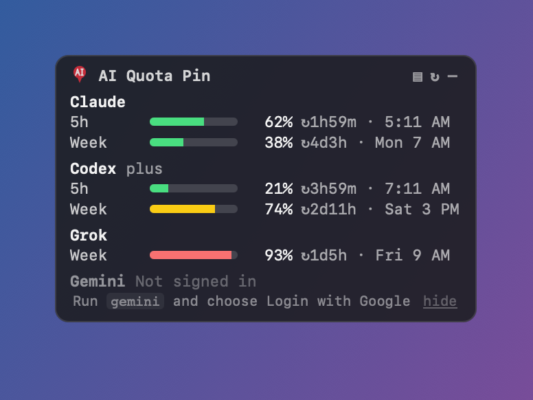
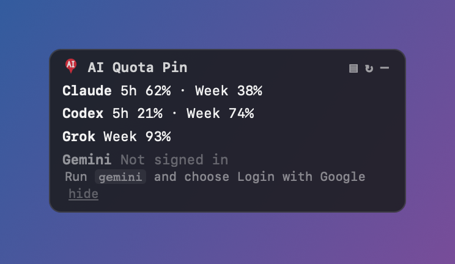

# AI Quota Pin

A small sticky note that stays on top of your other windows and shows how much of your AI coding plans you have used:
**Claude Code, Codex, Grok, Cursor and Gemini CLI**. It shows 5-hour and weekly usage with reset countdowns.
Runs on **macOS, Windows and Linux**. The app is about 5 MB, uses about 25 MB of RAM and almost no CPU.

<p align="center"></p>

> Screenshots use built-in demo values (`AIQP_DEMO=1`), not real account data.

## Platform status
| OS | Status |
|---|---|
| macOS 13+ (Apple silicon) | **Tested** daily: panel, pin, tray, autostart, all providers |
| Windows 10/11 | Built and checked by CI. Not yet tested by hand. Reports welcome |
| Linux (X11/Wayland) | Built and checked by CI. Not yet tested by hand. Staying on top on every workspace depends on your window manager |

## How it looks & options
| Expanded | Compact | Collapsed pin |
|---|---|---|
|  |  |  |

- **Expanded**: one row per usage window, with a bar (green, then yellow at 70%, red at 90%), % used, time until reset and the local reset time.
- **Compact** (the `▤` button or the tray): one line per provider.
- **Collapsed** (the `–` button): the panel shrinks to a small **AI pin**. Click the pin to expand it again. Drag it to move it.
- **Not signed in** (the Gemini row above): the provider name, a one-line fix such as "Run `gemini` and choose Login with Google", and a **hide** link.
- **Moving it**: drag the panel or the pin anywhere, on any monitor. The position is saved between restarts. If that display is
  gone, the panel moves back on screen. Top-right is only the default.
- **Panel buttons**: `▤` compact/expanded · `↻` refresh now · `–` collapse to the pin.
- **Tray / menu-bar icon** (on macOS the icon also shows the highest % in use):
  - *Show / Hide* shows or hides the panel.
  - *Compact / Expanded* switches the view.
  - *Refresh now* checks all providers now. Rate limits still apply.
  - *Reset position* moves the panel back to the top-right corner.
  - *Show hidden providers* brings back rows you hid.
  - *Quit AI Quota Pin* closes the app.

## Supported providers
| Provider | What it needs | Shows | Data source |
|---|---|---|---|
| Claude Code | Signed in with `claude` (Pro/Max) | 5h + weekly % (+ Opus/Sonnet weekly when present), resets | macOS Keychain `Claude Code-credentials`, or `~/.claude/.credentials.json` (`CLAUDE_CONFIG_DIR`). Calls Anthropic's OAuth usage endpoint. If that fails, estimates from `~/.claude/projects/**/*.jsonl` |
| Codex | Signed in with `codex login` (ChatGPT plan) | 5h / weekly %, resets, plan | Newest `~/.codex/sessions/**/*.jsonl` `rate_limits` (no network needed). Falls back to `~/.codex/auth.json` and ChatGPT's usage endpoint (`CODEX_HOME`) |
| Grok | Signed in with `grok login` | Weekly credit %, reset, use per product | `~/.grok/auth.json` (`GROK_HOME`) and the Grok CLI billing endpoint |
| Cursor | Cursor app signed in | Monthly plan %, end of billing cycle | Cursor's `state.vscdb`, opened read-only, and Cursor's usage-summary endpoint |
| Gemini CLI | `gemini` signed in with Google | Sign-in status only (no public quota API yet) | `~/.gemini/oauth_creds.json` |

Want another provider? Adding one is a single Rust file. See [CONTRIBUTING.md](CONTRIBUTING.md).

## Privacy
- **AI Quota Pin never asks for passwords.** There is no account, no server, no analytics and no telemetry.
- It only reads credentials and session files that your installed CLIs already keep on your machine.
- It only calls each provider's own usage endpoint, the same ones those CLIs and dashboards use.
- Tokens are sent only to the provider they belong to. They are never logged, saved or shown.
- The only files it writes are `prefs.json` (position, view, hidden rows) and `claude-usage.json` (the last usage numbers) in its settings folder.

## Set up with AI
Paste this into **Claude Code, Codex or Cursor** in an empty folder:

```text
Clone https://github.com/sandeepmvl/ai-quota-pin and build and install it for my OS.
1. Install what's missing: Rust (rustup), Node.js 18+, and on Linux the Tauri v2 system packages
   (libwebkit2gtk-4.1-dev libayatana-appindicator3-dev librsvg2-dev libxss-dev); on Windows the
   MSVC Build Tools and WebView2.
2. Run `npm install` then `npm run build` in the repo.
3. Install the result from src-tauri/target/release/bundle/: on macOS copy the .app to /Applications,
   on Windows run the .msi, on Linux install the .deb/.rpm or chmod +x the .AppImage.
4. Make it start at login (macOS: packaging/macos/io.github.sandeepmvl.aiquotapin.plist in
   ~/Library/LaunchAgents and `launchctl bootstrap gui/$(id -u)` it; Windows: shortcut in shell:startup;
   Linux: .desktop file in ~/.config/autostart).
5. Launch it and tell me which provider rows show numbers and which show "Not signed in".
Do not read, print or copy any of my credential files yourself.
```

## Manual setup
Prebuilt installers will be on [Releases](../../releases) once a release is published. Until then, build from source.

### macOS
```bash
xcode-select --install                                   # compiler tools
curl --proto '=https' --tlsv1.2 -sSf https://sh.rustup.rs | sh   # Rust
brew install node                                         # Node 18+
git clone https://github.com/sandeepmvl/ai-quota-pin && cd ai-quota-pin
npm install && npm run build -- --bundles app
cp -R "src-tauri/target/release/bundle/macos/AI Quota Pin.app" /Applications/
# start at login
cp packaging/macos/io.github.sandeepmvl.aiquotapin.plist ~/Library/LaunchAgents/
launchctl bootstrap gui/$(id -u) ~/Library/LaunchAgents/io.github.sandeepmvl.aiquotapin.plist
```
Downloaded builds are not signed or notarized, so **Gatekeeper** may say the app "is damaged" or "can't be opened". Either right-click the app → **Open** → **Open** (on macOS 15+: System Settings → Privacy & Security → **Open Anyway**), or run `xattr -dr com.apple.quarantine "/Applications/AI Quota Pin.app"`.

### Windows (PowerShell)
```powershell
winget install Rustlang.Rustup OpenJS.NodeJS.LTS Git.Git
winget install Microsoft.VisualStudio.2022.BuildTools --override "--add Microsoft.VisualStudio.Workload.VCTools --includeRecommended"
# WebView2 is preinstalled on Windows 10/11
git clone https://github.com/sandeepmvl/ai-quota-pin; cd ai-quota-pin
npm install; npm run build
# install: src-tauri\target\release\bundle\msi\*.msi  (or nsis\*-setup.exe)
```
Builds are not code-signed yet, so Windows **SmartScreen** may say *"Windows protected your PC"*. Click **More info → Run anyway**.
If your browser blocks the download, choose *Keep*. To start at login, press `Win+R`, open `shell:startup` and add a shortcut to *AI Quota Pin*.

### Linux (Debian/Ubuntu; use the equivalent packages on other distros)
```bash
sudo apt install build-essential curl git libwebkit2gtk-4.1-dev libayatana-appindicator3-dev librsvg2-dev libxss-dev
curl --proto '=https' --tlsv1.2 -sSf https://sh.rustup.rs | sh
# Node 18+ from nodejs.org or nvm
git clone https://github.com/sandeepmvl/ai-quota-pin && cd ai-quota-pin
npm install && npm run build
sudo apt install ./src-tauri/target/release/bundle/deb/*.deb    # or run the .AppImage
cp /usr/share/applications/ai-quota-pin.desktop ~/.config/autostart/   # start at login (name may vary)
```
The tray icon needs AppIndicator support. On GNOME, install the *AppIndicator and KStatusNotifierItem* extension.

## Troubleshooting
- **Claude row says "rate limited" or "stale · retrying in Xm" (HTTP 429)**: Anthropic limits how often the usage endpoint
  can be called, and other tools polling it use up the same allowance. AI Quota Pin calls it at most once every 3 minutes and saves the
  last good result to disk. It follows `Retry-After` and backs off from 5 up to 60 minutes. Meanwhile it shows the last known values,
  or a local **est.** row (tokens and messages in the current 5h window). Wait for it to recover, and check that you aren't running other tools that poll the same endpoint.
- **"Not signed in"**: run the command shown in the row (`claude` then `/login`, `codex login`, `grok login`, `gemini`, or sign in to
  Cursor). The row updates on the next refresh. If you don't use that tool, click **hide**.
- **macOS asks for Keychain access**: the app reads Claude Code's token with `security`. Choose *Always Allow*.
- **Numbers look old**: press `↻`. Codex numbers come from your last Codex session, so they update when you use Codex.
- **The panel is off screen**: tray → *Reset position*.
- **Only one copy runs**: launching the app again just shows the panel that is already open.
- **Try it with sample data**: `AIQP_DEMO=1 "/Applications/AI Quota Pin.app/Contents/MacOS/ai-quota-pin"`.

## Quit / uninstall
Tray → **Quit AI Quota Pin**. To uninstall:
```bash
# macOS
launchctl bootout gui/$(id -u)/io.github.sandeepmvl.aiquotapin
rm ~/Library/LaunchAgents/io.github.sandeepmvl.aiquotapin.plist
rm -rf "/Applications/AI Quota Pin.app" ~/Library/Application\ Support/ai-quota-pin
```
- **Windows**: uninstall from Settings → Apps, then delete `%APPDATA%\ai-quota-pin`.
- **Linux**: remove the package, then delete `~/.config/ai-quota-pin` and the autostart entry.

## How it compares
| | ccusage | CodexBar | Usagebar / Tankful | **AI Quota Pin** |
|---|---|---|---|---|
| Form | Terminal CLI | macOS menu bar | macOS menu bar | Floating note + tray |
| Live plan limits & resets | No (token cost) | Yes | Yes | Yes |
| Windows / Linux app | No | No (Linux CLI only) | No | Yes |
| Stays visible over full-screen apps | No | No | No | Yes |

## License
MIT. Not affiliated with Anthropic, OpenAI, xAI, Google or Anysphere.
